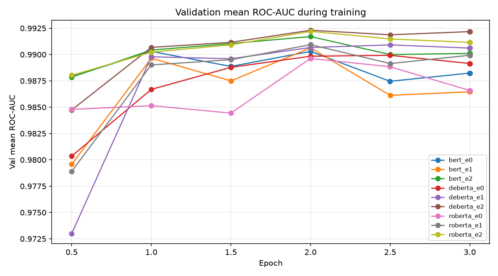

# Results

Generated by `src/evaluate.py` from `outputs/`; do not edit by hand.

Metrics follow plan §6.1; F1 uses threshold 0.5.

## 1. 主表：Jigsaw official labeled test

| Run | Model | Setting | Val mean ROC-AUC | Mean ROC-AUC | Mean PR-AUC | Macro F1 |
|---|---|---|---|---|---|---|
| bert_e0 | bert | e0 | 0.9903 | 0.9856 | 0.6523 | 0.5853 |
| bert_e1 | bert | e1 | 0.9907 | 0.9863 | 0.6684 | 0.5999 |
| bert_e2 | bert | e2 | 0.9917 | 0.9864 | 0.6852 | 0.6263 |
| roberta_e0 | roberta | e0 | 0.9897 | 0.9843 | 0.6618 | 0.6073 |
| roberta_e1 | roberta | e1 | 0.9909 | 0.9854 | 0.6295 | 0.5873 |
| roberta_e2 | roberta | e2 | 0.9922 | 0.9861 | 0.6718 | 0.6154 |
| deberta_e0 | deberta | e0 | 0.9899 | 0.9844 | 0.6561 | 0.5963 |
| deberta_e1 | deberta | e1 | 0.9909 | 0.9849 | 0.6461 | 0.5937 |
| deberta_e2 | deberta | e2 | 0.9923 | 0.9862 | 0.6638 | 0.5942 |

## 2. Per-label：Jigsaw official labeled test

**ROC-AUC**

| Run | toxic | severe_toxic | obscene | threat | insult | identity_hate |
|---|---|---|---|---|---|---|
| bert_e0 | 0.9734 | 0.9896 | 0.9807 | 0.9961 | 0.9810 | 0.9927 |
| bert_e1 | 0.9763 | 0.9900 | 0.9823 | 0.9961 | 0.9807 | 0.9921 |
| bert_e2 | 0.9743 | 0.9901 | 0.9825 | 0.9971 | 0.9814 | 0.9929 |
| roberta_e0 | 0.9733 | 0.9881 | 0.9819 | 0.9907 | 0.9805 | 0.9910 |
| roberta_e1 | 0.9750 | 0.9887 | 0.9816 | 0.9958 | 0.9805 | 0.9909 |
| roberta_e2 | 0.9738 | 0.9888 | 0.9826 | 0.9979 | 0.9811 | 0.9925 |
| deberta_e0 | 0.9737 | 0.9903 | 0.9826 | 0.9876 | 0.9820 | 0.9901 |
| deberta_e1 | 0.9749 | 0.9907 | 0.9819 | 0.9924 | 0.9807 | 0.9887 |
| deberta_e2 | 0.9752 | 0.9900 | 0.9820 | 0.9963 | 0.9823 | 0.9915 |

**PR-AUC**

| Run | toxic | severe_toxic | obscene | threat | insult | identity_hate |
|---|---|---|---|---|---|---|
| bert_e0 | 0.8095 | 0.3531 | 0.7886 | 0.4981 | 0.7819 | 0.6825 |
| bert_e1 | 0.8243 | 0.3453 | 0.8106 | 0.5860 | 0.7586 | 0.6857 |
| bert_e2 | 0.8075 | 0.3537 | 0.8116 | 0.6329 | 0.7915 | 0.7139 |
| roberta_e0 | 0.8050 | 0.2809 | 0.8053 | 0.6339 | 0.7773 | 0.6684 |
| roberta_e1 | 0.8200 | 0.2842 | 0.8036 | 0.5127 | 0.7637 | 0.5928 |
| roberta_e2 | 0.8035 | 0.3003 | 0.8131 | 0.6489 | 0.7856 | 0.6795 |
| deberta_e0 | 0.8077 | 0.3467 | 0.8118 | 0.5146 | 0.7925 | 0.6635 |
| deberta_e1 | 0.8171 | 0.3776 | 0.8118 | 0.4939 | 0.7575 | 0.6184 |
| deberta_e2 | 0.8108 | 0.3179 | 0.8107 | 0.6117 | 0.7922 | 0.6394 |

## 3. Δ 表（Jigsaw test；主實驗 runs：ratio 1、seed 42）

**bert**

| Δ ROC-AUC | Mean | toxic | severe_toxic | obscene | threat | insult | identity_hate |
|---|---|---|---|---|---|---|---|
| E1 − E0（hard augmentation） | +0.0007 | +0.0029 | +0.0004 | +0.0016 | +0.0000 | -0.0002 | -0.0005 |
| E2 − E0（soft augmentation） | +0.0008 | +0.0008 | +0.0006 | +0.0018 | +0.0010 | +0.0004 | +0.0002 |
| E2 − E1（soft vs. hard） | +0.0001 | -0.0021 | +0.0001 | +0.0002 | +0.0010 | +0.0007 | +0.0007 |

| Δ PR-AUC | Mean | toxic | severe_toxic | obscene | threat | insult | identity_hate |
|---|---|---|---|---|---|---|---|
| E1 − E0（hard augmentation） | +0.0161 | +0.0147 | -0.0078 | +0.0221 | +0.0879 | -0.0232 | +0.0032 |
| E2 − E0（soft augmentation） | +0.0329 | -0.0020 | +0.0006 | +0.0231 | +0.1348 | +0.0097 | +0.0314 |
| E2 − E1（soft vs. hard） | +0.0168 | -0.0168 | +0.0084 | +0.0010 | +0.0469 | +0.0329 | +0.0282 |

**roberta**

| Δ ROC-AUC | Mean | toxic | severe_toxic | obscene | threat | insult | identity_hate |
|---|---|---|---|---|---|---|---|
| E1 − E0（hard augmentation） | +0.0011 | +0.0017 | +0.0005 | -0.0004 | +0.0051 | +0.0000 | -0.0001 |
| E2 − E0（soft augmentation） | +0.0019 | +0.0005 | +0.0007 | +0.0007 | +0.0072 | +0.0006 | +0.0015 |
| E2 − E1（soft vs. hard） | +0.0007 | -0.0011 | +0.0002 | +0.0010 | +0.0021 | +0.0006 | +0.0016 |

| Δ PR-AUC | Mean | toxic | severe_toxic | obscene | threat | insult | identity_hate |
|---|---|---|---|---|---|---|---|
| E1 − E0（hard augmentation） | -0.0323 | +0.0149 | +0.0033 | -0.0017 | -0.1211 | -0.0136 | -0.0755 |
| E2 − E0（soft augmentation） | +0.0100 | -0.0015 | +0.0194 | +0.0077 | +0.0150 | +0.0083 | +0.0111 |
| E2 − E1（soft vs. hard） | +0.0423 | -0.0164 | +0.0161 | +0.0095 | +0.1362 | +0.0218 | +0.0866 |

**deberta**

| Δ ROC-AUC | Mean | toxic | severe_toxic | obscene | threat | insult | identity_hate |
|---|---|---|---|---|---|---|---|
| E1 − E0（hard augmentation） | +0.0005 | +0.0013 | +0.0005 | -0.0007 | +0.0048 | -0.0013 | -0.0014 |
| E2 − E0（soft augmentation） | +0.0018 | +0.0015 | -0.0003 | -0.0006 | +0.0087 | +0.0003 | +0.0014 |
| E2 − E1（soft vs. hard） | +0.0013 | +0.0003 | -0.0008 | +0.0001 | +0.0038 | +0.0016 | +0.0028 |

| Δ PR-AUC | Mean | toxic | severe_toxic | obscene | threat | insult | identity_hate |
|---|---|---|---|---|---|---|---|
| E1 − E0（hard augmentation） | -0.0101 | +0.0094 | +0.0310 | -0.0000 | -0.0206 | -0.0350 | -0.0451 |
| E2 − E0（soft augmentation） | +0.0077 | +0.0031 | -0.0287 | -0.0011 | +0.0972 | -0.0003 | -0.0241 |
| E2 − E1（soft vs. hard） | +0.0177 | -0.0063 | -0.0597 | -0.0011 | +0.1178 | +0.0347 | +0.0210 |

## 4. Cross-dataset：Civil test（五類）

| Run | Mean ROC-AUC | Mean PR-AUC | Macro F1 |
|---|---|---|---|
| bert_e0 | 0.9439 | 0.4045 | 0.3306 |
| bert_e1 | 0.9721 | 0.5769 | 0.5539 |
| bert_e2 | 0.9797 | 0.5890 | 0.4979 |
| roberta_e0 | 0.9274 | 0.3924 | 0.2998 |
| roberta_e1 | 0.9738 | 0.5715 | 0.5544 |
| roberta_e2 | 0.9813 | 0.5834 | 0.5194 |
| deberta_e0 | 0.9312 | 0.3983 | 0.3534 |
| deberta_e1 | 0.9709 | 0.5974 | 0.5840 |
| deberta_e2 | 0.9814 | 0.6026 | 0.5512 |

**ROC-AUC**

| Run | toxic | obscene | threat | insult | identity_hate |
|---|---|---|---|---|---|
| bert_e0 | 0.9249 | 0.9684 | 0.9442 | 0.9342 | 0.9481 |
| bert_e1 | 0.9613 | 0.9862 | 0.9646 | 0.9702 | 0.9780 |
| bert_e2 | 0.9649 | 0.9886 | 0.9871 | 0.9731 | 0.9850 |
| roberta_e0 | 0.9286 | 0.9487 | 0.8787 | 0.9419 | 0.9389 |
| roberta_e1 | 0.9620 | 0.9822 | 0.9731 | 0.9703 | 0.9814 |
| roberta_e2 | 0.9659 | 0.9907 | 0.9891 | 0.9737 | 0.9874 |
| deberta_e0 | 0.9352 | 0.9624 | 0.9014 | 0.9472 | 0.9097 |
| deberta_e1 | 0.9626 | 0.9820 | 0.9620 | 0.9702 | 0.9780 |
| deberta_e2 | 0.9679 | 0.9899 | 0.9866 | 0.9753 | 0.9872 |

**PR-AUC**

| Run | toxic | obscene | threat | insult | identity_hate |
|---|---|---|---|---|---|
| bert_e0 | 0.5971 | 0.3554 | 0.2519 | 0.5989 | 0.2190 |
| bert_e1 | 0.7542 | 0.5914 | 0.3682 | 0.7640 | 0.4065 |
| bert_e2 | 0.7488 | 0.5755 | 0.4244 | 0.7757 | 0.4206 |
| roberta_e0 | 0.6071 | 0.3238 | 0.2149 | 0.6274 | 0.1890 |
| roberta_e1 | 0.7528 | 0.5805 | 0.3607 | 0.7645 | 0.3991 |
| roberta_e2 | 0.7471 | 0.5524 | 0.4303 | 0.7668 | 0.4206 |
| deberta_e0 | 0.6037 | 0.3435 | 0.2401 | 0.6446 | 0.1593 |
| deberta_e1 | 0.7663 | 0.5962 | 0.4212 | 0.7647 | 0.4385 |
| deberta_e2 | 0.7593 | 0.5750 | 0.4696 | 0.7789 | 0.4301 |

## 5. 錯誤分析：deberta（Jigsaw test，threshold 0.5）

| Setting | toxic FP / FN | severe_toxic FP / FN | obscene FP / FN | threat FP / FN | insult FP / FN | identity_hate FP / FN |
|---|---|---|---|---|---|---|
| e0 | 5,628 / 400 | 283 / 210 | 2,552 / 474 | 207 / 56 | 1,657 / 668 | 510 / 175 |
| e1 | 5,315 / 399 | 587 / 117 | 2,032 / 628 | 266 / 46 | 2,060 / 603 | 504 / 203 |
| e2 | 4,934 / 407 | 625 / 127 | 2,093 / 643 | 326 / 25 | 2,306 / 460 | 521 / 173 |

**E0 → E2 預測翻轉**

| Flip | toxic | severe_toxic | obscene | threat | insult | identity_hate |
|---|---|---|---|---|---|---|
| FN → TP | 127 | 83 | 61 | 34 | 259 | 48 |
| TP → FN | 134 | 0 | 230 | 3 | 51 | 46 |
| TN → FP | 557 | 351 | 198 | 168 | 875 | 158 |
| FP → TN | 1,251 | 9 | 657 | 49 | 226 | 147 |

E0 false negatives（每類最多 20 筆，seed 42；實際 threat 20 筆、identity_hate 20 筆）已存到 `error_samples_deberta.csv`，供人工閱讀。

## 6. 訓練曲線

